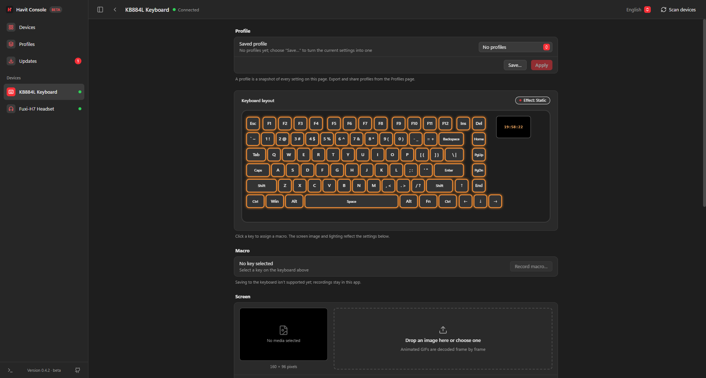
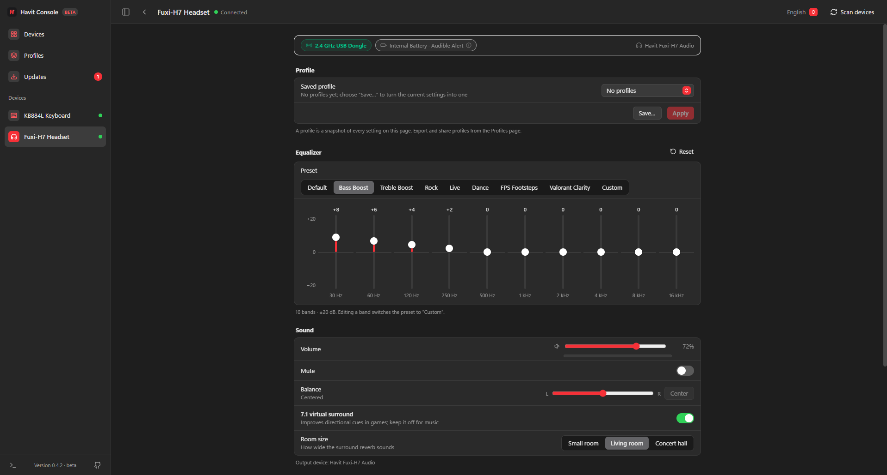

<div align="center">


# Havit Console

**A single, lightweight, open-source control center for Havit gaming peripherals.**

[](LICENSE)
[](https://tauri.app)
[](https://www.rust-lang.org/)
[](https://react.dev)
[](https://github.com/emirhannaneli/havit-console/actions/workflows/ci.yml)

</div>

---

## Why

The vendor software is closed source, uses hundreds of megabytes of RAM in the background and
needs one program per device. Havit Console replaces it with one small app built with
**Tauri v2 + Rust + React**, based on a clean-room reverse engineering of the vendor
protocols ([`morluto/rea`](https://github.com/morluto/rea) + Ghidra).

- **Light:** sits in the system tray, no background services.
- **Privacy-first:** no ads, user analytics or account requirements. Settings stay on the hardware and in local profiles. During open beta, anonymous device compatibility reports (USB VID/PID only, no personal data) help expand hardware support and can be disabled anytime in Settings.
- **Direct:** talks to the hardware over USB HID and Windows CoreAudio; no extra drivers.
- **Independent:** a community project, not affiliated with Havit.

---

## Supported devices

### Havit KB884L RGB TFT gaming keyboard
`VID 0x05AC`, `PID 0x024F` (HFD RKGK890 OEM, SONiX MCU)

<p align="center">
  
</p>

- **Lighting:** all 20 vendor effects with color, random-color mode, brightness, speed and
  direction. The keyboard image previews the selected effect live.
- **160×96 screen:** upload GIF, PNG, JPG or WEBP (up to 255 frames) with fit / fill / stretch
  placement and dithering so the preview matches the panel. The last uploaded animation is
  shown on start (from this app or the Havit app's database).
- **Clock:** sync the screen clock with the PC.
- **Settings:** Windows key lock, Fn lock, lighting sleep timer.
- **Macros:** record key sequences (writing them to the keyboard is not supported yet).

### Havit Fuxi-H7 wireless gaming headset
`VID 0x040B`, `PID 0x0897`

<p align="center">
  
</p>

- **Audio:** volume, mute and left/right balance (relative to the master volume) via CoreAudio.
- **Microphone:** gain and mute.
- **Equalizer and effects:** 10-band EQ with presets, 7.1 virtual surround, room size, noise
  cancellation and sidetone. These are host-side and remembered between launches.

### Profiles, updates, diagnostics

- **Profiles** capture a device's full configuration; apply them from the device page or the
  Profiles page, export and import them as JSON.
- **Updates** come from GitHub Releases through the built-in updater (signed installers).
- **Diagnostics** shows the live log of every packet exchanged with the devices.

The keyboard cannot report its configuration back, so the app shows the last known state
(what it applied itself, else what the Havit app saved). See
[`docs/kb884l-firmware-notes.md`](docs/kb884l-firmware-notes.md) for why reading it back
would require replacing the firmware.

---

## Performance & Resource Usage

Havit Console is engineered for zero background overhead, minimal memory consumption, and ultra-low latency hardware control.

### Resource Footprint vs. Vendor Software

| Metric | Official Havit Drivers (Per Device) | Havit Console (Unified) | Advantage |
| :--- | :--- | :--- | :--- |
| **RAM (Working Set)** | ~250 MB – 320 MB (multi-process Electron) | **~35 MB – 52 MB** | **~85% less RAM** |
| **Private Commit** | ~120 MB – 180 MB | **~12 MB** | **~90% less memory commit** |
| **Background Processes** | 3 – 5 background services per device | **0 background services** (1 single tray app) | No system clutter |
| **Idle CPU Usage** | 0.5% – 2.0% | **< 0.1%** | Zero CPU drain |
| **Binary / Bundle Size** | ~150 MB – 250 MB per installer | **~12.8 MB** (NSIS installer) | **~95% smaller** |
| **Cold Start Time** | ~2.5 – 4.0 seconds | **< 350 ms** | **~10× faster startup** |
| **Telemetry & Tracking** | Always-on background vendor telemetry & analytics servers | **Privacy-first / No user tracking** · Anonymous open-beta hardware compatibility reports (toggleable) | Zero personal data, no accounts |

### Subsystem Latency & Throughput (Release Benchmarks)

Measured on Windows 11 x64 (AMD Ryzen / Intel Core):

- **160×96 TFT Screen Codec (`dither_rgb888_to_rgb565`):**
  - **48.4 µs (0.048 ms)** per frame
  - **20,660 frames/sec** theoretical encoding throughput
  - An entire 60-frame animated GIF is processed, color-quantized, and packed in under **3 ms**.
- **Windows CoreAudio Peak Meter (`query_peaks`):**
  - **1.34 ms** average latency per query
  - **741 queries/sec** throughput (polled smoothly at 25 fps using < 3.4% of a single CPU core).
- **USB HID Device Discovery (`discover_havit_devices`):**
  - **115.9 ms** full USB bus and interface enumeration, executed asynchronously in the background.
- **Hardware Command Dispatch (Lighting / Settings / Balance):**
  - **< 2.5 ms** direct USB HID Feature Report write latency with zero audible DAC crackling.

---

## Open beta

Havit Console is in open beta. The KB884L and Fuxi-H7 are verified on real hardware; every
other Havit device is only detected. During the open beta, **share compatibility reports** is enabled
to help catalog untested Havit models and driver errors (sending only USB VID/PID, firmware version,
and sanitized driver error logs; never personal names, file paths, or serial numbers). It can be
turned off at any time during onboarding or in **Updates → Settings**. You can also manually review
and submit reports via **Report compatibility…**. Details: [`docs/compatibility-reports.md`](docs/compatibility-reports.md).

## Install

Download `Havit Console_X.Y.Z_x64-setup.exe` from the
[latest release](https://github.com/emirhannaneli/havit-console/releases/latest). It installs
per user (no administrator prompt) and updates itself afterwards.

Requirements: Windows 10/11 64-bit. WebView2 is installed automatically if missing.

---

## Develop

```bash
git clone https://github.com/emirhannaneli/havit-console.git
cd havit-console
npm install
npm run tauri dev      # desktop app with hot reload
npm run tauri build    # NSIS installer in src-tauri/target/release/bundle/nsis/
```

Requirements: Node.js 22, Rust stable (MSVC), Windows. `npm run dev` alone serves a browser
preview with mock devices at `http://localhost:1420`.

Versioning and releases follow Conventional Commits and release-please; see
[`docs/releasing.md`](docs/releasing.md).

---

## Protocol documentation

- [`docs/protocols/kb884l.md`](docs/protocols/kb884l.md) — KB884L HID transactions, lighting,
  settings, clock and screen upload.
- [`docs/protocols/fuxi-h7.md`](docs/protocols/fuxi-h7.md) — Fuxi-H7 audio endpoints and dongle.
- [`docs/ECOSYSTEM_FAMILIES.md`](docs/ECOSYSTEM_FAMILIES.md) — Havit model families and OEMs.
- [`docs/kb884l-firmware-notes.md`](docs/kb884l-firmware-notes.md) — firmware research.

---

## Contributing

Issues and pull requests are welcome. Commit messages follow
[Conventional Commits](https://www.conventionalcommits.org/) (`feat:`, `fix:`, …) because
they drive the version number.

## License

MIT — see [`LICENSE`](LICENSE).
